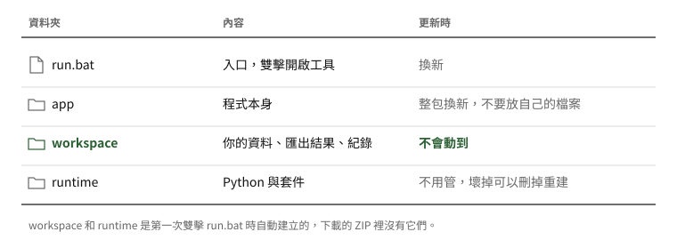

# 資料處理器使用手冊

把 Excel 裡的原始資料，依照 recipe 整理成可以交出去的資料表。有疑慮的地方會標記出來，你在畫面上確認、修正後再下載。全部在你的電腦上執行，資料不會上傳到任何地方。

## 1. 安裝與啟動

### 第一次安裝

不需要先安裝 Python，工具會自己準備。

**步驟一：取得工具。** 到公司 GitLab 專案的 **Releases** 頁，下載最新的 `data-processor-版本.zip`。

**步驟二：解壓縮。** 解壓到固定位置，例如 `文件\data-processor`。不要在壓縮檔裡直接執行。

> 從瀏覽器下載的 ZIP 要先解除封鎖再解壓，不然雙擊 `run.bat` 可能跳出安全性警告或沒有反應。步驟見[換版說明](update-guide.md)第 2 節。

**步驟三：啟動。**

- **Windows**：雙擊 `run.bat`。
- **macOS**：開啟終端機，進入資料夾後輸入 `bash run.sh`。

第一次會自動下載 uv 和 Python，約 1 到 3 分鐘。套件已經附在 ZIP 裡，不需要連到 PyPI。完成後瀏覽器會自動開啟工具。

啟動後，工具資料夾會長這樣：

記住一件事就好：**你的資料都在 `workspace`**。`app` 是程式本身，每次更新都會整包換掉，不要在裡面放自己的檔案。

> 全部都在這個資料夾內，電腦上原本的 Python 不受影響，也不會改動系統設定。不想用了，刪掉整個資料夾就好；要保留資料的話，先備份 `workspace`。

### 之後每次使用

雙擊 `run.bat` 就好。那個黑色視窗就是工具本身，**使用時不要關掉**。

用完時，關閉瀏覽器頁面或黑色視窗都可以。關閉頁面約 10 秒後，工具會自動結束。工具已經開著時再雙擊 `run.bat`，只會開啟原本的頁面，不會多開一個。

工具右上角的「使用手冊」連結可以隨時開啟這份手冊，左上角顯示目前的版本號。

### 更新與退回版本

更新到新版、新版有問題時退回，都寫在 **[換版說明](update-guide.md)**，有圖解。換版不會動到 `workspace` 裡的資料。

### 公司電腦不能連網，或擋 GitHub

套件已經附在 ZIP 裡，只有第一次的 uv 和 Python 需要從 GitHub 下載。如果公司擋 GitHub：

1. 在一台能連網的 Windows 64 位元電腦上解壓 ZIP，雙擊 `run.bat` 一次，讓它下載完成。
2. 把整個資料夾複製到目標電腦，但不要複製 `runtime\venv`、`runtime\cache` 和 `workspace`。
3. 雙擊 `run.bat`，工具會直接使用複製過來的檔案，全程不連網。

## 2. 操作說明

### 什麼是 recipe

recipe 是一份文字檔，寫好「資料怎麼讀、哪些列不要、怎麼配對、代碼怎麼對照、輸出哪些欄位」。不同的資料用不同的 recipe，工具本身不用改。第一次啟動時會附一份範例 recipe 和範例資料，可以先試跑看看。

### 請 AI 寫 recipe

1. 按左邊 Recipe 的「新增」，再按「複製規格給 AI」。
2. 把規格貼給你的 AI，再說明你的資料和規則：有哪些工作表、欄位叫什麼、哪些列不處理、兩張表用什麼對、對不到時改用什麼、代碼要轉成什麼、最後要輸出哪些欄位。
3. 把 AI 寫好的 recipe 貼回「新增」的視窗，按「檢查並儲存」。
4. 有問題時視窗會列出所有問題，按「複製問題給 AI」，貼回去請它修正，再貼一次。

> 不要把真實資料貼給外部的 AI。用欄位名稱和幾列假資料說明就夠了。

### 處理一份資料

1. 在左邊選 recipe。
2. 選擇或拖曳 Excel 檔（.xlsx）。
3. 按「執行」。

上方的八張卡片是每個步驟的結果：讀到哪個工作表、排除幾列、哪些格子看不懂、配對了幾列、驗證找到幾個問題。橘色代表有需要檢查的地方，紅色代表無法執行（通常是找不到必要的欄位，畫面會說明原因）。

### 檢查與修正

- **結果**：預設只顯示需要檢查的列。橘色底的格子有問題，滑鼠停在上面可以看原因；灰色斜體是看不懂的原始內容。點一列會在右邊打開細節，可以直接修改，按 Enter 儲存。修改會保留原值，按「還原」可以改回來。
- **配對**：列出找不到、有多筆候選、需要確認的配對，左右並列比較，相同的欄位標綠、不同的標橘。可以「選這筆」、「手動指定」、「確定沒有配對」，或在配對正確時按「確認正確」。
- **對照待補**：列出對照表裡沒有的寫法（例如「陸運」），選好對應值按「儲存」。之後處理其他檔案也會自動套用。
- **排除**：被篩掉的列與原因。
- **所有警示**：全部的問題，可以勾選後一次「確認無誤」。

你做的修改、指定的配對、確認過的警示都會記下來。同一份檔案重新執行，或 recipe 修改後再執行，這些決定都還在。

### 下載

按右上角「下載 Excel」。檔案裡有：

| 工作表 | 內容 |
|---|---|
| 整理結果 | 輸出的資料，加上檢查狀態、問題說明、來源列；有問題的格子有底色，人工修改的格子有註解寫原值 |
| 待檢查 | 所有警示 |
| 配對明細 | 每一列用哪個方式配到哪一列 |
| 排除 | 被篩掉的列 |
| 對照待補 | 還沒補上對照的寫法 |

下載的檔案也會在 `workspace/output` 留一份。

## 3. 檔案與資料安全

| 資料夾 | 內容 |
|---|---|
| `workspace/output` | 匯出的檔案 |
| `workspace/recipes` | 你的 recipe |
| `workspace/mappings` | 在畫面上補的對照 |
| `workspace/reviews` | 你的修改、指定的配對、確認過的警示 |
| `workspace/samples` | 範例資料 |
| `workspace/uploads` | 上傳到工具的暫存複本，結束時清除 |
| `workspace/logs` | 操作與錯誤紀錄，不記檔名和資料內容 |

工具只接受本機（127.0.0.1）的連線，其他網站無法透過瀏覽器讀取或操作工具裡的資料。遇到錯誤時，畫面只顯示一般訊息，詳細原因寫在 `workspace/logs/app.log`，回報問題時附上這個檔案即可。匯出的檔案不會自動清除，請依公司規定保管。

## 4. 常見問題

**顯示「無法下載 uv」或「環境建立失敗」**
通常是公司網路阻擋 GitHub，請改用第 1 節的離線安裝。

**安裝到一半中斷**
重新執行 `run.bat` 會接續完成。還是失敗時，刪除 `runtime` 資料夾再試一次。

**瀏覽器沒有自動開啟**
看黑色視窗裡顯示的網址，例如 `http://127.0.0.1:8765`，貼到瀏覽器。

**畫面顯示「工具已經關閉」**
黑色視窗被關掉了。重新執行 `run.bat`，再重新整理頁面。

**更新後有問題**
執行 `run.bat rollback` 退回上一版，並把版本號和 `workspace/logs/app.log` 回報給負責人。詳細步驟見[換版說明](update-guide.md)。
