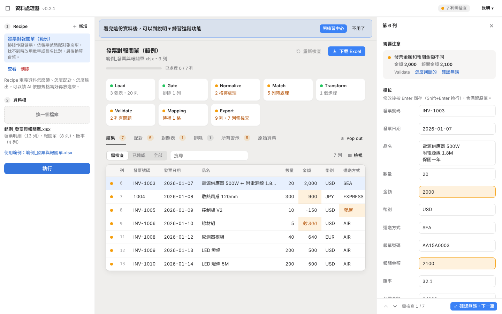
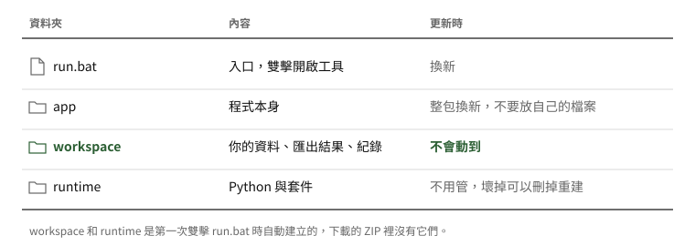
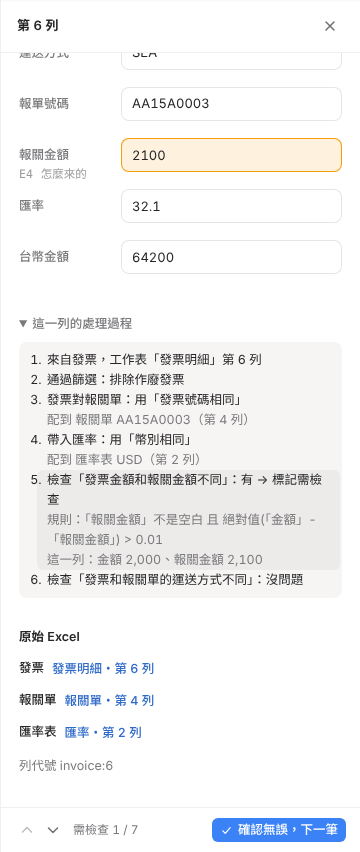
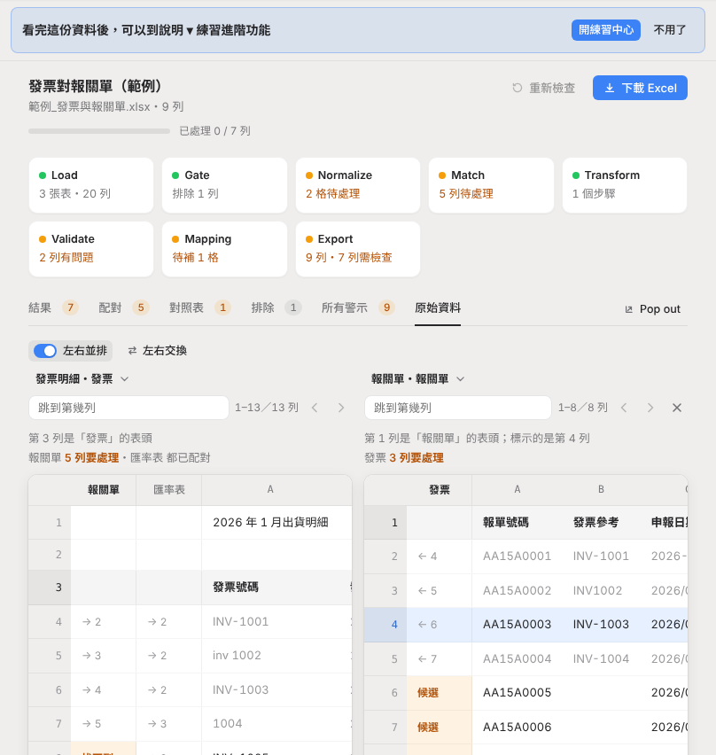

# 資料處理器使用手冊

把 Excel 裡的原始資料，依照 recipe 整理成可以交出去的資料表。有疑慮的地方會標記出來，你在畫面上確認、修正後再下載。全部在你的電腦上執行，資料不會上傳到任何地方。

這份手冊是**參考手冊**。操作步驟由工具內的導覽和實地練習直接帶你做，這裡保留規則細節、例外情況與排錯方法。

## 1. 快速上手

第一次打開資料處理器，中間畫面有三個入口：

- **用範例資料邊做邊學**（約 5 分鐘）：用內建的發票與報關單範例，實際走完執行、看流程卡片、確認、修改、補對照、選配對、回原始資料、下載的完整流程。
- **練習放入 recipe**：不需先找 AI，直接練習複製規格、貼回、看問題清單、看白話說明並儲存。
- **用自己的資料開始**：左邊選 recipe、拖進 Excel 檔，按「執行」。

關掉導覽後，右上角的「說明 ▾」選單隨時可以重開導覽、看進階功能說明卡、或做寫 recipe 的實地練習。範例與練習的結果和人工決定都會存放在暫存資料夾，不會影響正式資料。



## 2. 安裝、更新與退回

### 第一次安裝

不需要先安裝 Python，工具會自己準備。

**步驟一：取得工具。** 到公司 GitLab 專案的 **Releases** 頁，下載最新的 `data-processor-版本.zip`。

**步驟二：解壓縮。** 解壓到固定位置，例如 `文件\data-processor`。不要在壓縮檔裡直接執行。

> 從瀏覽器下載的 ZIP 要先解除封鎖再解壓，不然雙擊 `run.bat` 可能跳出安全性警告或沒有反應。步驟見[換版說明](update-guide.md)第 2 節。

**步驟三：啟動。**

- **Windows**：雙擊 `run.bat`。
- **macOS**：開啟終端機，進入資料夾後輸入 `bash run.sh`。

第一次會自動下載 uv 和 Python，約 1 到 3 分鐘。套件已經附在 ZIP 裡，不需要連到 PyPI。完成後瀏覽器會自動開啟工具。

啟動後，工具資料夾會長這樣：



記住一件事就好：**你的資料都在 `workspace`**。`app` 是程式本身，每次更新都會整包換掉，不要在裡面放自己的檔案。

> 全部都在這個資料夾內，電腦上原本的 Python 不受影響，也不會改動系統設定。不想用了，刪掉整個資料夾就好；要保留資料的話，先備份 `workspace`。

### 之後每次使用

雙擊 `run.bat` 就好。那個黑色視窗就是工具本身，**使用時不要關掉**。

用完時，關閉瀏覽器頁面或黑色視窗都可以。關閉頁面約 10 秒後，工具會自動結束。工具已經開著時再雙擊 `run.bat`，只會開啟原本的頁面，不會多開一個。

工具右上角的「說明 ▾ → 使用手冊」可以隨時開啟這份手冊，左上角顯示目前的版本號。建議使用寬度 1000px 以上的桌面視窗以獲得最佳版面。

### 更新與退回版本

更新到新版、新版有問題時退回，都寫在 **[換版說明](update-guide.md)**，有圖解。換版不會動到 `workspace` 裡的資料。

### 公司電腦不能連網，或擋 GitHub

套件已經附在 ZIP 裡，只有第一次的 uv 和 Python 需要從 GitHub 下載。如果公司擋 GitHub：

1. 在一台能連網的 Windows 64 位元電腦上解壓 ZIP，雙擊 `run.bat` 一次，讓它下載完成。
2. 把整個資料夾複製到目標電腦，但不要複製 `runtime\venv`、`runtime\cache` 和 `workspace`。
3. 雙擊 `run.bat`，工具會直接使用複製過來的檔案，全程不連網。

## 3. 功能參考

### 3.1 處理一份資料

執行後上方會列出流程卡片，反映資料經過的八個步驟，點開任一張卡片可以查看摘要並直接跳到對應分頁：

| 步驟 | 做什麼 |
|---|---|
| Load | 依 `aliases` 找表頭與工作表，讀進每一列原始資料 |
| Gate | 依條件過濾不用處理的列（例如作廢、小計），移到「排除」分頁 |
| Normalize | 清理空白與全半形、擷取欄位、解析日期與數字、套用對照表 |
| Match | 依 recipe 排好的比對方式順序，把多張表配在一起 |
| Transform | 依 SQL 計算衍生欄位或整理資料表 |
| Validate | 依條件檢查數值或跨欄邏輯，不合的標為「需檢查」或「提示」 |
| Mapping | 彙整這次套用的對照與人工修改紀錄 |
| Export | 整理成最終輸出欄位，隨時可下載成 Excel |

### 3.2 檢查與修正

#### 看這一格是怎麼來的 {#help-trace}

- **什麼時候用**：不懂某個值為什麼長這樣，或想知道驗證警示是怎麼算出來的。
- **怎麼操作**：在右側細節中，點欄位旁的「怎麼來的」看欄位轉換步驟；點驗證警示上的「怎麼判斷的」展開規則與用到的每個值；點儲存格位置（例如 `E6`）跳出原始儲存格小卡。
- **例子**：原始儲存格 `USD 3,450.00` → 金額 `3450`，幣別放另一欄。
- **常見錯誤**：看不到「怎麼判斷的」是因為該警示屬於讀取或解析失敗，直接點欄位旁的儲存格位置看原值即可。
- **在工具裡練習**：說明 ▾ → 看這一格是怎麼來的 → 試試看。



#### 兩張表並排，找配對的答案 {#help-source}

- **什麼時候用**：某張單據找不到配對，想直接翻原始 Excel 確認是不是單號打錯或真的沒有。
- **怎麼操作**：按配對卡片或細節裡的表格圖示看小卡，再按「完整工作表」切到「原始資料」分頁，打開「左右並排」。原始表列號旁的配對欄會把沒用到的列標成橘色。
- **例子**：左邊發票、右邊報關單，橘色「沒用到」就是剩下的候選。
- **常見錯誤**：多對一時再按一次配對欄的列號連結即可切換到下一筆對應列。
- **在工具裡練習**：說明 ▾ → 兩張表並排，找配對的答案 → 試試看。



#### 一次確認很多筆 {#help-bulk}

- **什麼時候用**：同一類需要人工判斷的警示有很多筆，逐列點太花時間。
- **怎麼操作**：切到「所有警示」分頁，可先由流程卡片點「查看」聚焦單一類別，勾選或按「全選」，再按「確認無誤（n）」。
- **例子**：所有警示勾選 → 確認無誤。
- **常見錯誤**：無法勾選的項目是「缺資料或必須處理」的錯誤（例如讀不懂、找不到配對），必須先修正或指定。
- **在工具裡練習**：說明 ▾ → 一次確認很多筆 → 試試看。

#### 清掉重來，按錯可以復原 {#help-reset}

- **什麼時候用**：修改或確認亂掉了，想把這個檔案的人工決定全部清掉重頭檢查。
- **怎麼操作**：按右上角「重新檢查」兩次確認清除。清完後畫面下方提示列會出現「復原」按鈕，按錯時可立刻還原。
- **例子**：重新檢查 → 清掉 n 項 → 復原。
- **常見錯誤**：重新檢查只清掉這個檔案的修改、指定配對與確認，不會清掉「對照表」裡補上的對照。
- **在工具裡練習**：說明 ▾ → 清掉重來，按錯可以復原 → 試試看。

#### 表格太寬，搬到另一個螢幕 {#help-popout}

- **什麼時候用**：欄位很多，或想在兩個螢幕一邊看結果表、一邊看配對或原始資料。
- **怎麼操作**：按分頁列右上角「Pop out ↗」把目前分頁搬到獨立視窗，兩邊修改即時同步。看完按「Pop in」或在主視窗按「全部 Pop in」收回來。
- **例子**：結果 Pop out ↗，配對留在主視窗。
- **常見錯誤**：瀏覽器擋下彈出視窗時，在網址列允許本機網站（`127.0.0.1`）開啟視窗再按一次。
- **在工具裡練習**：說明 ▾ → 表格太寬，搬到另一個螢幕 → 試試看。

#### 只看需要的欄位 {#help-columns}

- **什麼時候用**：結果表欄位太多，想暫時隱藏次要欄位，或切換換行、緊湊顯示。
- **怎麼操作**：在結果表右上角打開「檢視」選單，勾選要顯示的欄位，或切換「換行」「緊湊」。設定會依 recipe 記住，不影響下載的 Excel 欄位。
- **例子**：隱藏幣別與匯率，只留發票號碼、金額與台幣金額。
- **常見錯誤**：找不到某一欄時，打開「檢視」按「全部顯示」。

### 3.3 寫 recipe

#### 排除不用處理的列 {#help-gate}

- **什麼時候用**：工作表裡夾雜作廢、測試、小計等不該進入後續比對的列。
- **怎麼設**：在 `gate` 底下指定 `input`、`keep`（SQL 條件，符合才保留）與 `label`。
- **例子**：狀態 `作廢` → 放進「排除」。
- **常見錯誤**：SQL 裡空白值是 `NULL`，寫 `status <> '作廢'` 會連空白都排掉，要寫 `status IS NULL OR status <> '作廢'`。
- **在工具裡練習**：說明 ▾ → 排除不用處理的列 → 實地練習。

#### 各種寫法統一成同一個代碼 {#help-mapping}

- **什麼時候用**：同一個概念在原始檔裡有中文、英文、縮寫等多種寫法。
- **怎麼設**：在 `mappings` 定義 `values`（允許代碼）、`entries`（各代碼對應的原始寫法清單）與 `missing: ask`，並在欄位加上 `map: 對照表名稱`。
- **例子**：`快遞`、`Courier` → `EXPRESS`。
- **常見錯誤**：新增寫法不在 `values` 清單裡時，要一起補進 `values` 或在介面選「新增對應值」。
- **在工具裡練習**：說明 ▾ → 各種寫法統一成同一個代碼 → 實地練習。

#### 號碼寫法不同也配得到 {#help-match}

- **什麼時候用**：兩張表的單號格式不一致（例如一邊有前綴或符號，另一邊只有數字）。
- **怎麼設**：在 `match` 的 `strategies` 依序排多種比對方式；前面配不到才試下一種。可用 `dp_digits()` 只比數字、或 `dp_key()` 與 `jaro_winkler_similarity()` 比相似度。
- **例子**：`1004` 對 `INV-1004`。
- **常見錯誤**：只比數字時要加 `when: "dp_digits(l.invoice_no) <> ''"`，避免兩邊都沒有數字時誤配成空字串相等。
- **在工具裡練習**：說明 ▾ → 號碼寫法不同也配得到 → 實地練習。

#### 一格有好幾行，只取需要的那行 {#help-extract}

- **什麼時候用**：品名或備註一格塞了好幾行，只要其中一行或某個關鍵字後的文字。
- **怎麼設**：在欄位設定底下加 `extract`，可用 `line`（1 是第一行、-1 是最後一行）、`after`、`before`、`regex`。
- **例子**：`電源供應器 500W↵附電源線…` → `電源供應器 500W`。
- **常見錯誤**：`extract` 要寫在該欄位的設定物件底下（與 `aliases` 同層），不要寫在 `inputs` 外面。
- **在工具裡練習**：說明 ▾ → 一格有好幾行，只取需要的那行 → 實地練習。

#### 數字對不上時提醒我 {#help-validate}

- **什麼時候用**：兩張表的金額、數量或代碼需要互相核對，有差異時標記出來。
- **怎麼設**：在 `validate` 底下寫 `where`（觸發條件）、`message`（警示文字）與 `highlight`（要標示的輸出欄位清單）。
- **例子**：金額 `2,000`、報關 `2,100` → 需檢查。
- **常見錯誤**：浮點數相減可能有微小誤差，建議寫 `abs(amount - decl_amount) > 0.01`，且加上 `decl_amount IS NOT NULL` 避免沒配到時重複報錯。
- **在工具裡練習**：說明 ▾ → 數字對不上時提醒我 → 實地練習。

#### 用公式算出新欄位 {#help-transform}

- **什麼時候用**：需要換匯、加總、依條件給值或組合多個欄位。
- **怎麼設**：在 `transform` 底下寫 `name`、`note` 與單一 `SELECT` SQL，並在 `output.columns` 參照新欄位名稱。
- **例子**：金額 × 匯率 → 台幣金額。
- **常見錯誤**：SQL 只能是單一 `SELECT`，不能加分號 `;`，也不能使用 `CREATE`、`DROP` 或讀取外部檔案。
- **在工具裡練習**：說明 ▾ → 用公式算出新欄位 → 複製給 AI 的提問。

#### 多個檔案一起處理 {#help-multi-files}

- **什麼時候用**：同類資料分散在多張工作表。
- **怎麼設**：在 `inputs.<表>.sheet` 放多個工作表名稱或使用萬用字元，工具會依表頭自動對齊並合併成同一張輸入表，每一列都會保留原本的工作表名稱與列號。
- **例子**：`sheet: [1月發票, 2月發票]` → 合併處理並於細節標示來源工作表。
- **常見錯誤**：各工作表的欄位名稱不同時，把不同寫法都列進該欄位的 `aliases`。

## 4. 看懂輸出

### 狀態顏色

| 顏色 | 代表意思 |
|---|---|
| 綠色 | 沒問題（已自動完成或已配對） |
| 橘色 | 需檢查（金額不同、多筆候選、找不到配對、不在對照表、讀不懂） |
| 紅色 | 找不到或無法執行（缺少必要工作表或欄位、SQL 錯誤） |
| 藍色 | 你處理過的（人工修改、人工指定、確認無誤、已補對照） |

### 哪些警示一定要先處理

細節下方的「確認無誤，下一筆」只會一鍵確認**要人判斷**的警示（例如金額差額、需確認的模糊配對）。以下類別必須先修正、補對照或指定配對：

- `required`（必填空白）
- `extract`、`parse`（擷取或格式解析失敗，例如數字寫成「約 300」）
- `unmapped`（不在對照表）
- `match_ambiguous`、`match_none`、`match_overflow`、`match_shared`（配對待選或找不到）

### 下載的 Excel 內容

下載的 `.xlsx` 會包含：整理結果工作表（套用所有人工修改、配對與對照，並保留數值與日期型別）、排除列工作表、處理摘要與警示紀錄。每次下載也會在 `workspace/output` 留一份備份。範例模式下載的檔名會加上「示範_」前綴。

## 5. 讓 AI 幫你寫 recipe {#help-ai-recipe}

### 適合交給 AI 的事

- 依你的工作表與欄位名稱，起草整份 recipe。
- 補一條新的 `match` 比對方式（例如忽略前綴、比對日期區間）。
- 寫一個 `extract` 規則（從多行文字或固定關鍵字擷取欄位）。
- 寫一段 `transform` 或 `validate` 的 SQL 條件。

### 要告訴 AI 的工具規則

下列規則和程式實際檢查一致：

- 只輸出 YAML；不可使用 YAML 錨點（`&`）、別名（`*`）或自訂 `!` 標籤。
- 鍵名與布林字面值（`on`、`yes`、`no`）在工具裡當作一般文字，不當布林值。
- SQL 只能是單一 `SELECT` 或運算式，**不能有分號**，單次查詢超過 120 秒會中止；沙盒讀不到磁碟檔案也不能連網。
- 名稱（recipe id、表名、欄位代號）要以英文字母開頭，不能用 `dp_` 或 `_` 開頭。
- 內建可用函數：`dp_key(text)`（去空白符號並正規化）、`dp_digits(text)`（只留數字）、`jaro_winkler_similarity(a, b)`、`levenshtein(a, b)`、DuckDB 正規表達式與視窗函數。
- 遇到判斷不了的情況不要硬塞預設值，讓它留空或標成 `review: true`、`missing: ask`、`unmatched: flag`，交給人在畫面上確認。

### 可直接複製的提問範本

**請 AI 寫整份 recipe：**

```text
請依我附上的 recipe 規格，寫一份 YAML recipe：
1. 工作表與欄位：（列出工作表名稱、欄位名稱）
2. 排除條件：（哪些列不要處理）
3. 配對方式：（哪兩張表怎麼對，對不到改用什麼）
4. 驗證與輸出：（要檢查什麼，最後輸出哪些欄位）
只輸出完整 YAML，不要加其他說明。
```

**請 AI 修改或新增一小段：**

```text
請在下面這份 recipe 的 [gate / mappings / match / extract / validate] 位置，幫我補上這個規則：
（說明你的規則與欄位名稱）
只輸出要放進該位置的 YAML 片段，縮排從第 0 欄開始。
```

**貼回問題清單請 AI 修正：**

直接按對話框裡的「複製問題給 AI」，工具會自動整理成清單並附帶修正指示。

### 貼回驗證的流程

1. 按左欄「新增」，貼上 AI 寫好的 YAML，按「下一步：確認說明」。
2. 有錯誤會出現問題清單，按「複製問題給 AI」請它改好再貼回。
3. 通過檢查後，逐句讀「每一列會經過」的白話說明，確認和你想的規則一致再按「確認並儲存」。
4. 用一份資料試跑，看流程卡片的數字與單列「處理過程」是否合理。

### 什麼時候不該用規則

如果判斷高度依賴人工閱讀原始文件、或是只有一兩筆一次性例外，直接在工具裡人工修改或手動指定配對會比寫複雜規則更快、更安全。

## 6. 常見問題

### 執行前

- **「執行」按鈕是灰色的**：確認左欄已選取沒有問題的 recipe，而且已經放入 `.xlsx` 或 `.xlsm` 檔案。舊版 `.xls` 請先用 Excel 另存成 `.xlsx`。
- **找不到工作表或必要欄位**：看問題訊息列出的表頭名稱，把實際欄名補進該欄位的 `aliases`。

### 執行後看不懂

- **數值變成空白且底色橘色**：原始文字夾雜無法解析的字（例如「約 300」），點那一列看右側細節的「原始：…」提示並手動修改。
- **不知道驗證為什麼觸發**：點警示上的「怎麼判斷的」，工具會列出規則條件與該列用到的每個值。

### 配對

- **出現「待選擇」**：同一筆條件對到多筆候選，比較各候選差異欄位後按「選這筆」。
- **找不到配對**：按配對卡的表格圖示開原始表並排，看對面標成橘色「沒用到」的列。

### 對照表

- **補了對照卻還想改**：到「對照表」分頁的「已補上的對照」按「移除」，再重新補上正確代碼。

### 下載

- **下載的檔名有「示範_」**：目前在範例模式，改用自己的 Excel 檔重新執行就會以正式檔名匯出。

### 更新

- **上方出現「工具已更新，關掉所有視窗後重新執行 run.bat」**：瀏覽器開著舊版伺服器或快取頁面，關閉所有視窗後重新雙擊 `run.bat`。

## 7. 管理與維護

- **資料夾分工**：`app/` 是程式（更新會換掉），`workspace/` 放你的 recipe、對照表、人工紀錄、匯出檔與紀錄檔。
- **備份與搬電腦**：只要備份或複製整個 `workspace/` 資料夾即可。
- **紀錄檔**：放在 `workspace/logs/`，只記操作摘要與錯誤追蹤，不記錄檔名與表格資料內容。

## 附錄：速查

### 鍵盤快捷鍵

| 按鍵 | 作用 |
|---|---|
| `J` / `K` | 結果表切到下一列 / 上一列（在輸入框打字時不作用） |
| `Enter` | 細節欄位儲存修改（文字欄位 `Shift+Enter` 換行） |
| `Esc` | 依序關閉原始資料小卡、說明選單、說明卡、新功能小卡、導覽外框 |

### Recipe 頂層設定一覽

| 設定 | 必填 | 用途 |
|---|---|---|
| `recipe` | 是 | 規格版本，固定寫 `1` |
| `id`、`name` | 是 | 英文代號（與檔名相同）與顯示名稱 |
| `inputs` | 是 | 來源工作表、欄位別名、型別、`extract`、`map` |
| `gate` | 否 | 篩選要保留的列，不符合的放進「排除」 |
| `mappings` | 否 | 代碼對照表（`values`、`entries`、`missing`） |
| `match` | 否 | 多階段比對（`one_to_one`、`many_to_one`、`one_to_many`、`many_to_many`） |
| `transform` | 否 | 用單一 `SELECT` SQL 計算新欄位 |
| `validate` | 否 | 跨欄檢查條件與 `highlight` 標示欄位 |
| `output` | 是 | 最終輸出工作表、排序與欄位清單 |
